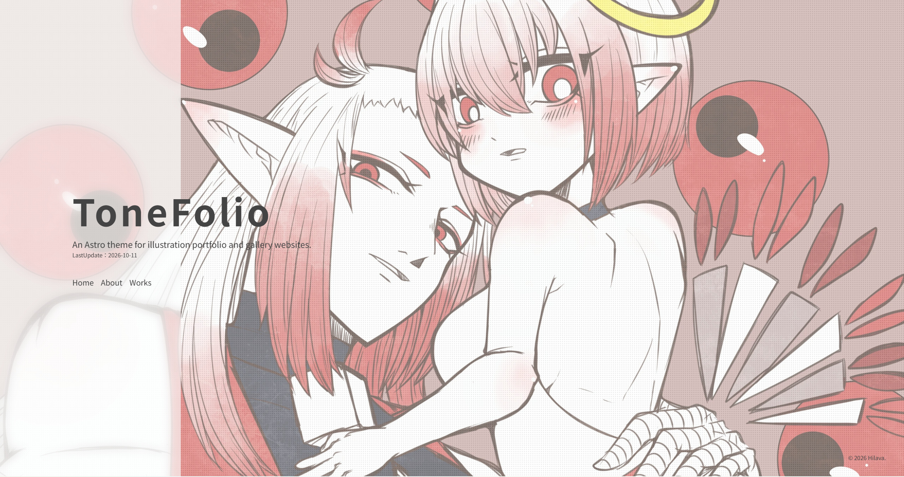
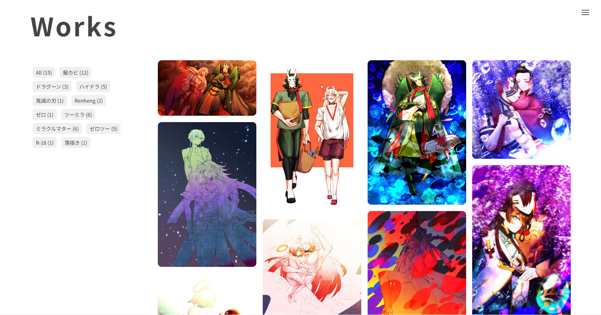
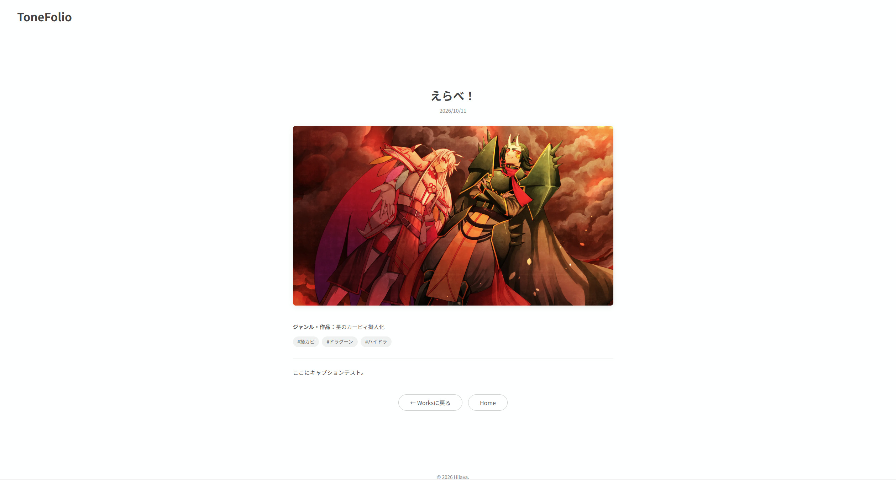

# ToneFolio
絵描きが絵描きさんのために開発した、無料のポートフォリオ・イラストサイト用テーマ

An Astro theme for illustration portfolio and gallery websites.

[🖥️ LiveDemo](https://tonefolio.hilavaarts.link/)

※マニュアルは整備中です

## ✨️ 特徴
- コード入力不要で簡単更新（Sveltia CMS対応）
- Masonryレイアウト
- PhotoSwipeによる画像拡大表示
- タグ絞り込み機能
- OGP対応 / レスポンシブ対応
- NSFW（R-18）ワンクッション機能

## 🚀Get Started
Use this templateからリポジトリをコピーしてはじめましょう！

## 📷️ スクリーンショット(デモサイト)
### トップページ

### ギャラリーページ

### 作品詳細ページ

## 🙏 技術スタック / 使用ライブラリ
- [Astro](https://astro.build/)
- [Sveltia CMS](https://sveltiacms.app/en/)
- [PhotoSwipe](https://photoswipe.com/)
- [MiniMasonry.js](https://spope.github.io/MiniMasonry.js/)
- [Swiper](https://swiperjs.com/)

## 🐞 不具合・要望
不具合報告や機能要望は [Issue](https://github.com/hilava999/tonefolio/issues) よりお気軽にお知らせください。

## 📝 ライセンス
[MIT License](./LICENSE)

## ⭐️ 最後に
このテーマが皆さんの創作活動のお役に立てれば嬉しいです。

## 🔁更新履歴
### 2026年10月16日
- CloudflareR2に対応
- ギャラリーページ・作品詳細ページの画像表示ロジック変更

## 🎨Janus
Hilavaが開発したイラストサイト向けテーマです！こちらもよろしくお願いいたします！  

[GitHub](https://github.com/hilava999/Janus) | [サンプルサイト](https://janus.hilavaarts.link/)

## 🛠️ 開発者情報
### Hilava
しがない絵描きです。たまに開発もします。創作とゲームとゲーム音楽が好き。  
テーマを使ってみてのご感想はWaveboxからお気軽にお寄せくださいね！  
[GitHub](https://github.com/hilava999) | [X](https://x.com/hilava_gkb) | [Wavebox](https://wavebox.me/wave/6f0sa4hla3csl7op/)