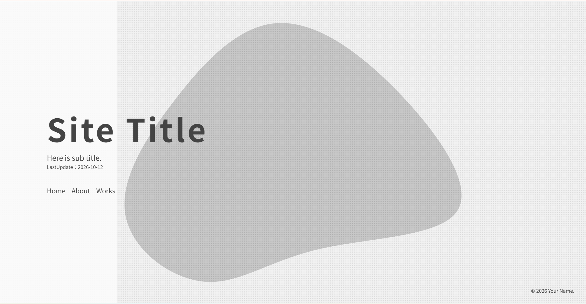
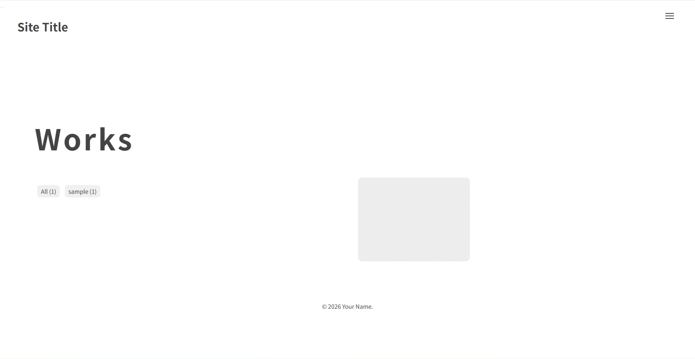
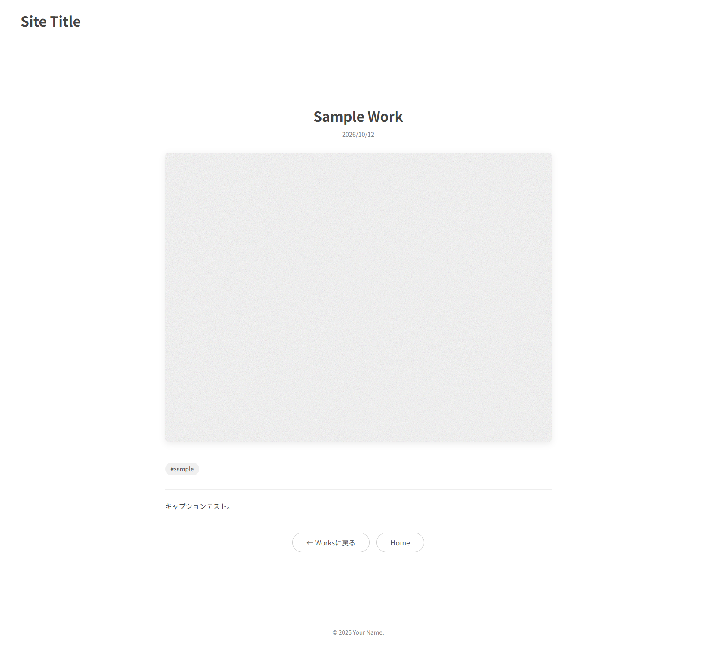

# ToneFolio
絵描きが絵描きさんのために開発した、無料のポートフォリオ・イラストサイト用テーマ

An Astro theme for illustration portfolio and gallery websites.

[🖥️ デモサイト](https://demo-tonefolio.pages.dev/)

## 💡 コンセプト
面倒なサーバー管理やコードの知識は一切不要。ブログ感覚で手軽に作品を追加・更新できるシステムに加え、R-18作品の自動ぼかしやワンクッションなど、イラストサイトに欠かせない「配慮」を標準搭載しています。サーバー代を完全無料に抑えながら、自身の創作に100%集中できる環境を提供します。是非、デモサイトをご確認ください！

## ✨️ 特徴
- ワンボタンでサイトを立ち上げられる
- コード入力不要で簡単更新（Sveltia CMS対応）
- Masonryレイアウト
- PhotoSwipeによる画像拡大表示
- タグ絞り込み機能
- OGP対応 / レスポンシブ対応
- NSFW（R-18）ワンクッション機能

## 📷️ スクリーンショット
### トップページ

### ギャラリーページ

### 作品詳細ページ

## 🙏 技術スタック / 使用ライブラリ
- [Astro](https://astro.build/)
- [Sveltia CMS](https://sveltia.github.io/sveltia-cms/)
- [PhotoSwipe](https://photoswipe.com/)
- [MiniMasonry](https://www.minimasonry.com/)
- [Swiper](https://swiperjs.com/)

## 🐞 不具合・要望
不具合報告や機能要望は [Issue](https://github.com/hilava999/tonefolio/issues) よりお気軽にお知らせください。

## 📝 ライセンス
[MIT License](./LICENSE)

## ⭐️ 最後に
このテーマが皆さんの創作活動のお役に立てれば嬉しいです。